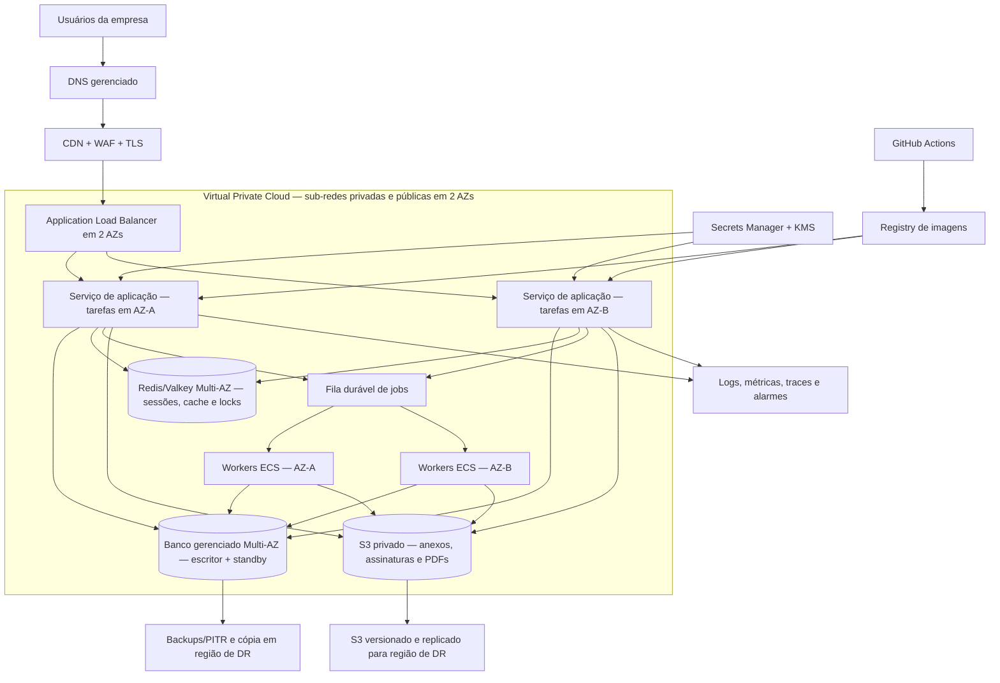

# Proposta de arquitetura de alta disponibilidade — Controle de Brindes

**Status:** proposta técnica; não implementada nem validada em produção.  
**Objetivo:** reduzir indisponibilidade por falha de instância ou zona, proteger dados e permitir recuperação de desastre regional.  
**Escopo:** aplicação, banco, sessões/cache, filas, arquivos, deploy, observabilidade e recuperação.

## 1. Premissas e decisão necessária

O repositório documenta duas gerações da aplicação:

- aplicação PHP legada na raiz, conectada a MySQL/MariaDB;
- backend Laravel 13 em `backend/`, que requer PHP 8.4 e usa PostgreSQL, enquanto o frontend ainda está em migração.

Essas versões não devem ser tratadas como uma única aplicação HA enquanto mantiverem bancos e fluxos operacionais independentes. Antes de implantar, o responsável precisa escolher qual versão é a fonte de verdade e definir uma janela de migração. Deve existir **um único caminho de escrita para estoque, solicitações e entregas**; dual-write entre MySQL e PostgreSQL não é recomendado.

Esta proposta adota AWS como exemplo concreto de arquitetura gerenciada. A mesma separação lógica pode ser implementada em outro provedor, desde que os serviços escolhidos ofereçam redundância real entre zonas, failover, backups recuperáveis e níveis de serviço compatíveis.

### Opções durante a migração

1. **Manter o legado como produção temporária:** duplicar instâncias da aplicação PHP sem estado local e usar banco MySQL/MariaDB gerenciado Multi-AZ. Laravel/PostgreSQL permanece em homologação até a migração e reconciliação dos dados.
2. **Concluir a migração para Laravel/PostgreSQL:** migrar a interface e os fluxos, validar os dados, fazer o corte controlado e então operar o desenho PostgreSQL abaixo.

A escolha do mecanismo do banco no diagrama depende dessa decisão: RDS MySQL/MariaDB durante a opção 1; RDS PostgreSQL após a opção 2. Não trocar o engine do banco apenas como parte da configuração de alta disponibilidade.

## 2. Desenho lógico proposto

### Componentes e responsabilidades

| Camada | Configuração proposta | Motivo/limite |
|---|---|---|
| DNS e borda | DNS gerenciado, CDN, WAF, certificados TLS e proteção contra abuso | Entrada controlada; WAF/CDN não substituem autorização no backend. |
| Entrada da aplicação | Load balancer gerenciado distribuído por pelo menos duas zonas | Verifica saúde e encaminha tráfego somente para tarefas saudáveis. |
| Aplicação | Containers PHP/Laravel em ECS Fargate, mínimo de duas tarefas em zonas diferentes e capacidade dimensionada para perda de uma zona | Tarefas sem estado local; substituir uma tarefa não deve encerrar sessões nem apagar arquivos. Em duas AZs, a AWS recomenda capacidade de duas vezes a demanda normal para manter resposta imediata à perda de uma zona. |
| Banco | RDS do engine escolhido, Multi-AZ, backups automáticos/PITR e criptografia | O standby Multi-AZ protege contra falhas de instância/zona; o standby de uma instância Multi-AZ não é para escalar leituras. |
| Sessão/cache/locks | Redis/Valkey gerenciado com Multi-AZ; dados de negócio permanecem no banco | Sessões compartilhadas entre tarefas e locks distribuídos; cache pode ser reconstruído. |
| Jobs | SQS e serviço independente de workers em duas zonas | Workers processam tarefas fora da requisição; cada job precisa tolerar repetição/idempotência. |
| Arquivos | Bucket S3 privado, bloqueio de acesso público, criptografia e versionamento | Assinaturas, PDFs e anexos não dependem do disco efêmero de containers. |
| Recuperação regional | Réplica/backup do banco e cópia versionada dos arquivos em região secundária | Multi-AZ cobre falhas dentro da região, não substitui DR regional. |
| Segredos | Secrets Manager/KMS, IAM de privilégio mínimo e segredos separados por ambiente | Segredos não ficam no GitHub, imagem Docker, logs ou `.env` versionado. |
| Deploy | GitHub Actions → testes/scan → registry → homologação → aprovação → produção | Atualizações progressivas, health checks e rollback automatizado. |
| Observabilidade | CloudWatch (ou equivalente), alarmes, logs centralizados e testes sintéticos | Detectar falhas antes e durante o incidente, sem registrar tokens ou dados pessoais desnecessários. |

## 3. Comportamento esperado em falhas

### Falha de uma tarefa/instância

O load balancer retira a tarefa não saudável e o orquestrador cria outra. Manter capacidade suficiente para que as tarefas restantes atendam a carga normal enquanto a substituição ocorre. Na recomendação da AWS para duas AZs, isso pode significar provisionar capacidade de duas vezes a demanda normal; autoscaling reativo não substitui essa reserva porque leva tempo para iniciar novas tarefas. Não depender de sessão aderente (sticky session) como mecanismo de disponibilidade.

### Falha de uma Availability Zone

As tarefas e workers na zona restante continuam ativos. A aplicação deve ter capacidade de sobra para operar sem a zona perdida. O banco Multi-AZ promove o standby conforme a configuração gerenciada; a aplicação precisa renovar conexões, aplicar timeouts razoáveis e repetir operações transitórias com backoff. A AWS informa que o failover típico de RDS Multi-AZ pode levar 60–120 segundos, mas isso não constitui garantia de RTO para o sistema inteiro.

### Falha da região principal

Ativar o plano de DR: verificar o incidente, promover a réplica do banco ou restaurar o ponto de recuperação, liberar a aplicação na região secundária, validar integridade e alterar o roteamento DNS. Réplicas cross-region são assíncronas; o RPO real depende do atraso de replicação. A promoção e o redirecionamento devem seguir runbook aprovado, com responsável e registro de decisão.

## 4. Sessões, concorrência e tarefas assíncronas

- Tornar todos os containers descartáveis: código e configuração na imagem; estado persistente fora do container.
- Guardar sessões Laravel em Redis ou banco compartilhado, nunca em arquivo local de uma tarefa. Para o legado PHP, migrar sessão para armazenamento compartilhado ou adotar autenticação centralizada antes de espalhar instâncias.
- Usar Redis para cache/locks, não como fonte única do saldo de estoque, aprovações ou comprovantes.
- Mover e-mail, geração de relatórios e tarefas demoradas para filas e workers independentes. Configurar jobs idempotentes, limite de tentativas, fila de falhas e alertas de idade/tamanho da fila.
- Executar o scheduler em mais de uma instância somente com lock compartilhado e exclusão de execução duplicada (`onOneServer()` no Laravel). Jobs devem tolerar repetição.
- Manter transações SQL para estoque e entrega. Chaves de idempotência e restrições de banco devem impedir débito duplicado em retries.
- Configurar health checks separados: liveness verifica que o processo responde; readiness verifica dependências necessárias sem revelar detalhes internos.

A documentação Laravel descreve o uso de cache compartilhado para tarefas agendadas de servidor único e mecanismos de fila/retry. O cache/lock compartilhado deve estar acessível por todas as instâncias.

## 5. Dados, backups e recuperação

### Banco

- Multi-AZ para disponibilidade intra-região; backups automáticos/PITR para recuperação de erro lógico ou exclusão acidental.
- Copiar backups/logs transacionais para outra região e, idealmente, conta/projeto administrativo separado.
- Definir retenção com o responsável por negócio e privacidade; criptografar backups e restringir quem pode restaurar/exportar.
- Não confundir réplica com backup: replicação pode propagar exclusões ou corrupção lógica.
- Testar restauração em ambiente isolado, conferir saldos de estoque, totais de solicitações, relações e login de teste.

### Arquivos

- Tornar S3 privado; conceder acesso via papel IAM e URLs assinadas de curta duração quando necessário.
- Habilitar versionamento para recuperação de sobrescrita/exclusão. Para DR, replicar os objetos para bucket em outra região; a replicação exige versionamento nos buckets de origem e destino.
- Definir política de ciclo de vida e retenção compatível com finalidade operacional e exigências contratuais/LGPD.

## 6. Disponibilidade, RTO e RPO

Metas iniciais sugeridas para validação com a empresa — **não são SLA do provedor nem garantia da arquitetura**:

| Cenário | Objetivo preliminar | Observações |
|---|---|---|
| Perda de uma tarefa | Recuperar tráfego em até 5 minutos | Depende dos health checks, inicialização e capacidade restante. |
| Falha de uma zona | RTO até 15 minutos; RPO de negócio definido para o banco | Testar failover e reconexão; o failover de banco é apenas uma parte do RTO completo. |
| Indisponibilidade regional | RTO até 4 horas; RPO até 15 minutos | Exige réplica/backup cross-region, aplicação pronta na região secundária e runbook ensaiado. |
| Exclusão/corrupção de dados | Restaurar a partir do PITR/backup dentro do RTO aprovado | Alta disponibilidade não corrige corrupção propagada; restauração deve ser testada. |

RTO = tempo máximo aceitável para retomar o serviço. RPO = quantidade máxima de dados que a empresa aceita perder, medida no tempo. O dono do processo deve aprovar essas metas e as consequências operacionais antes da contratação.

## 7. Segurança e governança operacional

- Banco, Redis e workers em sub-redes privadas; banco e Redis sem exposição direta à internet.
- Security groups com fluxo mínimo: somente ALB → aplicação; aplicação/worker → banco, Redis, S3, fila e serviços necessários.
- Separar produção, homologação e desenvolvimento, com contas/credenciais próprias. Usar IAM de privilégio mínimo e MFA para operadores.
- Criptografar tráfego TLS e dados em repouso; proteger chaves KMS e rotacionar segredos.
- Remover dados pessoais, assinaturas, tokens e credenciais de logs, métricas e alertas.
- Deploy imutável e revisão por pull request; migrations compatíveis para trás (expand/contract) antes de remover colunas/rotas antigas.
- Aplicar circuit breaker/rollback do deploy quando health checks falharem; nunca executar `migrate:fresh` em produção.
- Manter inventário de provedores, regiões, suboperadores, contatos de incidente e runbooks.

## 8. Observabilidade e alertas mínimos

Criar painéis e alertas para:

- disponibilidade externa de `/up`, `/api/v1/health` e `/api/v1/readiness`;
- taxa de erros HTTP 5xx, latência p95/p99 e falhas de login;
- tarefas saudáveis por zona, reinícios, CPU/memória e saturação do load balancer;
- conexões, CPU, armazenamento, deadlocks e failovers do banco;
- uso/latência do Redis, profundidade/idade da fila e jobs falhados;
- falhas em upload/download, armazenamento disponível e resultado de backup;
- custo por ambiente e alertas de orçamento.

O endpoint de readiness atual pode indicar conectividade de banco, chave, CORS e disco configurado. Isso não comprova sozinho que o bucket está privado, que o backup existe ou que uma restauração funciona; incluir esses testes operacionais no monitoramento e no runbook.

## 9. Plano de implantação por etapas

1. **Decisão e inventário:** identificar versão atualmente usada, banco real, integrações e dados; escolher MySQL/MariaDB legado temporário ou PostgreSQL Laravel alvo; aprovar RTO/RPO.
2. **Fundação:** criar infraestrutura via IaC (Terraform/CDK), redes em duas zonas, IAM, Secrets Manager, registry e ambientes separados.
3. **Aplicação sem estado:** empacotar a aplicação escolhida em containers, mover sessões/arquivos para serviços compartilhados e configurar health checks.
4. **Dados:** ativar banco gerenciado Multi-AZ, backups/PITR, criptografia e teste de restauração; migrar com reconciliação e plano de rollback.
5. **Filas e tarefas:** adotar fila durável e workers redundantes; validar idempotência, retries e scheduler com lock distribuído.
6. **Borda e tráfego:** configurar TLS, WAF, ALB, deploy progressivo, autoscaling com capacidade de reserva e alarmes.
7. **DR e exercícios:** preparar região secundária, replicar backups/arquivos e ensaiar falhas em homologação; registrar duração, perda de dados e ações pendentes.
8. **Produção:** liberar primeiro com tráfego controlado, verificar os SLOs e só então encerrar o caminho antigo, após reconciliação dos dados.

## 10. Critérios de aceite

- [ ] A empresa designou a versão e o banco que são a fonte oficial de escrita.
- [ ] Nenhum componente crítico depende de disco local, sessão local ou instância única.
- [ ] Há pelo menos duas tarefas saudáveis em zonas distintas e capacidade para absorver a perda de uma zona.
- [ ] Failover do banco e reconexão da aplicação foram testados em homologação.
- [ ] Jobs duplicados/reexecutados não duplicam movimento de estoque ou entrega.
- [ ] Arquivos estão privados, versionados e com replicação/backup conforme o RPO aprovado.
- [ ] Backup do banco foi restaurado com sucesso e reconciliação de dados registrada.
- [ ] A região de DR foi ativada em exercício cronometrado; RTO/RPO observados foram registrados.
- [ ] Alertas, responsáveis, runbooks, rollback e contatos de incidente foram aprovados.
- [ ] O custo mensal e o custo de operação foram aprovados; alta disponibilidade não significa custo igual ao plano básico.

## Referências técnicas

- [AWS — ECS: capacidade e disponibilidade em múltiplas Availability Zones](https://docs.aws.amazon.com/AmazonECS/latest/developerguide/capacity-availability-best-practice.html)
- [AWS — ECS: balanceamento de carga](https://docs.aws.amazon.com/AmazonECS/latest/developerguide/service-load-balancing.html)
- [AWS — ECS: health checks e estratégia de deploy](https://docs.aws.amazon.com/AmazonECS/latest/developerguide/service_definition_parameters.html)
- [AWS — ECS: deployment circuit breaker e rollback](https://docs.aws.amazon.com/AmazonECS/latest/developerguide/deployment-circuit-breaker.html)
- [AWS — RDS: Multi-AZ para PostgreSQL/MySQL/MariaDB](https://docs.aws.amazon.com/AmazonRDS/latest/UserGuide/Concepts.MultiAZSingleStandby.html)
- [AWS — RDS: failover Multi-AZ](https://docs.aws.amazon.com/AmazonRDS/latest/UserGuide/Concepts.MultiAZ.Failover.html)
- [AWS — RDS: recuperação regional e RTO/RPO](https://docs.aws.amazon.com/prescriptive-guidance/latest/strategy-database-disaster-recovery/choosing-database.html)
- [AWS — RDS: replicar backups para outra região](https://docs.aws.amazon.com/AmazonRDS/latest/UserGuide/USER_ReplicateBackups.html)
- [AWS — ElastiCache: failover Multi-AZ](https://docs.aws.amazon.com/AmazonElastiCache/latest/dg/AutoFailover.html)
- [AWS — S3: versionamento](https://docs.aws.amazon.com/AmazonS3/latest/userguide/Versioning.html)
- [AWS — S3: requisitos de replicação entre regiões](https://docs.aws.amazon.com/AmazonS3/latest/userguide/replication-requirements.html)
- [Laravel 13 — filas](https://laravel.com/docs/13.x/queues)
- [Laravel 13 — scheduler e execução em um servidor](https://laravel.com/docs/13.x/scheduling)
- [Supabase — regiões disponíveis e região primária do projeto](https://supabase.com/docs/guides/platform/regions)

## Documentação interna relacionada

- [Arquitetura e pastas do projeto](Arquitetura-e-Pastas.md)
- [Deploy produtivo atual](Deploy-Vercel-Producao.md)
- [Backup e restauração atual](Backup-e-Restauracao.md)
- [Estimativa de custos para profissionalização](Estimativa-de-Custos-Profissionalizacao.md)
